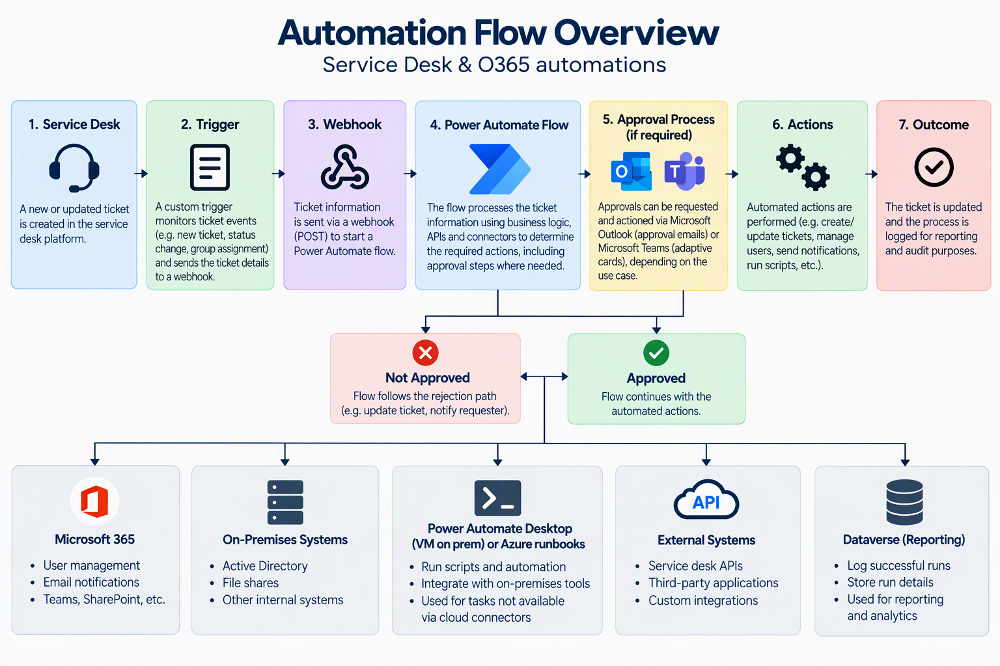
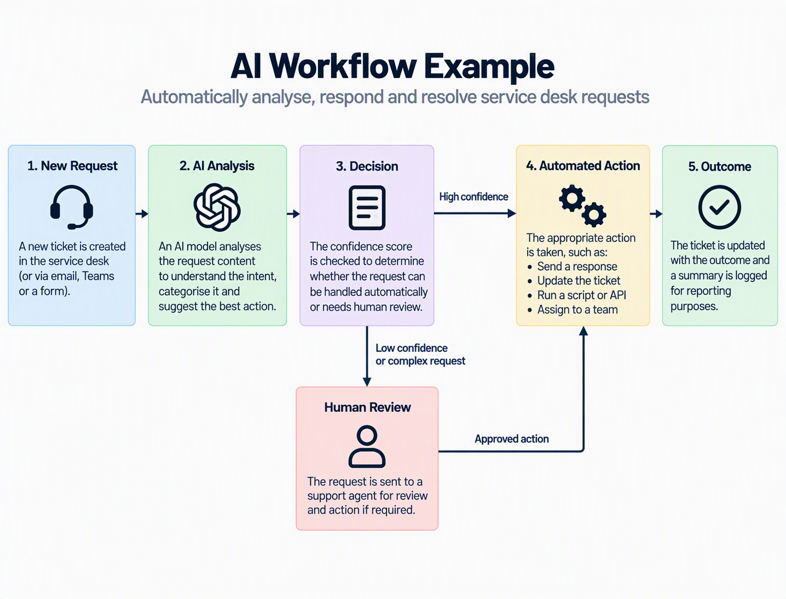

# IT Automation & AI Solutions Portfolio

I design and support practical automation solutions for IT service operations as well as some cases for the wider org. My work focuses on connecting service-management platforms, Microsoft 365, Power Platform, cloud APIs, desktop automation, data platforms, and AI services into reliable end-to-end processes.

This portfolio describes the architecture, methods, and project patterns I have worked with. Organisation-specific names, accounts, credentials, URLs, identifiers, and configuration values have been deliberately removed.

## What I Work On

- IT service desk workflow automation
- Power Automate cloud and desktop flows
- Microsoft Forms, Teams, Outlook, SharePoint, and Dataverse integrations
- REST APIs, JSON payloads, webhooks, and OAuth-based authentication
- PowerShell automation and Azure Automation runbooks
- Approval workflows and identity lifecycle processes
- Monitoring, exception handling, reporting, and audit logging
- Databricks, Delta tables, OCR, and AI-assisted search
- Copilot Studio and AI-assisted support workflows

## Reference Architecture

A common solution pattern connects an IT service-management platform with Microsoft 365 and Power Platform services. Requests may begin in a service desk, form, email, scheduled script, or monitoring process. Power Automate coordinates the workflow, while APIs and webhooks pass data between systems.

### Design principles

1. **Use event-driven automation where possible.** Webhooks reduce unnecessary polling and allow workflows to react to ticket or request changes.
2. **Keep orchestration separate from execution.** Cloud flows manage approvals, routing, notifications, and API calls, while scripts or runbooks handle operating-system and infrastructure tasks.
3. **Write results back to the system of record.** Status, notes, identifiers, and failure details should be recorded against the originating request.
4. **Log successful and failed runs.** Structured run data supports reporting, troubleshooting, and continuous improvement.
5. **Design for supportability.** Configuration, connection ownership, error paths, and dependencies should be documented so the solution can be maintained by another technician.

## AI Workflow for Tickets
(Saves several hours per week as well as Technician sanity)

## Selected Project Patterns

### Service Desk Ticket Automation

**Challenge:** Repetitive service requests required technicians to copy information between a ticketing platform, Microsoft 365, and administrative tools.

**Approach:**

- Triggered workflows from ticket events using webhooks.
- Passed a minimal JSON payload containing the request identifier and relevant request fields.
- Used REST API calls to retrieve full ticket details when required.
- Applied routing and validation logic in Power Automate.
- Sent progress notes, outcomes, or exceptions back to the original ticket.

**Skills:** webhook design, REST APIs, JSON, authentication, Power Automate, error handling, and service-management integration.

### Approval and Access Workflows

**Challenge:** Access requests needed consistent approvals, traceability, and different actions depending on the selected systems.

**Approach:**

- Collected structured request data through Microsoft Forms or a service request.
- Routed approvals through Teams or Outlook.
- Used conditional branches to handle approved, rejected, cancelled, and incomplete requests.
- Performed account or group actions through scripts, connectors, or APIs.
- Logged the approval outcome and execution result for audit purposes.

**Skills:** approval design, branching logic, Microsoft 365 integration, identity administration, audit trails, and exception management.

### Identity Lifecycle Automation

**Challenge:** User creation and offboarding processes involved multiple systems, duplicate checks, directory lookups, approvals, and timed follow-up actions.

**Approach:**

- Validated user and organisational-unit information before making changes.
- Checked for existing accounts to prevent duplicate creation.
- Resolved ambiguous directory matches through an approval step.
- Passed confirmed identifiers to a separate execution process.
- Supported different retention or deletion paths for offboarding.

**Skills:** Active Directory, PowerShell, Power Automate, validation, duplicate detection, approvals, and lifecycle controls.

### Infrastructure Monitoring and Automated Remediation

**Challenge:** Shared operational devices and display systems could stop responding, require re-authentication, or need a restart after updates.

**Approach:**

- Used scheduled PowerShell health checks to detect known failure conditions.
- Submitted alerts to a cloud workflow through a webhook.
- Created or updated service desk tickets automatically.
- Separated detection, remediation, and notification logic for easier troubleshooting.
- Identified cloud runbooks as a more maintainable replacement for workstation-dependent execution where practical.

**Skills:** PowerShell, monitoring, webhook integration, automated ticket creation, operational resilience, and migration planning.

### Endpoint Security Response Automation

**Challenge:** Security alerts required repeatable device lookup, scan initiation, result polling, and technician notification.

**Approach:**

- Extracted the affected device identifier from an alert.
- Queried an endpoint-security API for the matching managed device.
- Initiated an antivirus scan through an authenticated API call.
- Polled the task status and handled success, timeout, and failure states.
- Posted the outcome to the service desk or collaboration channel.

**Skills:** security API integration, OAuth authentication, state polling, Power Automate, and incident-response workflow design.

### Operational Reporting and Time-Saved Tracking

**Challenge:** Automation value and execution history needed to be measurable rather than anecdotal.

**Approach:**

- Logged qualifying successful runs to a structured data store.
- Captured fields such as workflow category, execution time, result, and estimated manual effort avoided.
- Used the stored records to generate recurring summaries.
- Excluded cancellations or non-qualifying runs to keep reporting meaningful.

**Skills:** Dataverse, data modelling, reporting logic, automation governance, and value measurement.

### AI-Assisted Service Desk Triage

**Challenge:** Some incoming requests could be resolved or routed more quickly by analysing their content.

**Approach:**

- Used an AI model to classify the request and select an appropriate response path.
- Applied explicit outcomes such as respond, initiate a supported action, mark resolved, or escalate.
- Kept deterministic workflow controls around the AI decision.
- Preserved a human escalation path for uncertain or higher-risk cases.

**Skills demonstrated:** AI workflow design, classification, guardrails, prompt design, escalation logic, and human-in-the-loop support.

### 8. Knowledge Search with Databricks and Delta Tables

**Challenge:** Large archives and technical documents were difficult to search accurately using basic document stores.

**Approach:**

- Loaded structured exports into Delta tables for analysis and retrieval.
- Prepared long technical documents using OCR and content splitting.
- Built AI-assisted search experiences over historical service data and technical manuals.
- Treated ingestion quality, chunking, metadata, and refresh processes as part of the solution rather than relying only on the final AI interface.

**Skills:** Databricks, Delta tables, OCR, document processing, semantic retrieval, data preparation, and AI search design.

### Document Extraction and Reconciliation

**Challenge:** Scanned business documents needed to be compared with system exports or checked against expected values.

**Approach:**

- Used OCR and document-intelligence services to extract values from scans.
- Applied mapping rules to normalise extracted data.
- Compared extracted records with structured exports.
- Presented exceptions for review rather than silently changing source data.

**Skills: OCR, document intelligence, data mapping, reconciliation, exception reporting, and review workflows.

## How I Approach an Automation Project

1. Map the current process, including owners, approvals, exceptions, and the system of record.
2. Identify which steps are deterministic and which require human judgement.
3. Define the trigger, input contract, authentication method, and expected outputs.
4. Build the smallest reliable end-to-end workflow before adding optional branches.
5. Add validation, idempotency, retries, timeouts, logging, and escalation paths.
6. Test normal, duplicate, missing-data, permission, timeout, and service-failure scenarios.
7. Document ownership, dependencies, credential rotation, support procedures, and recovery steps.
8. Measure run volume, failure patterns, and manual effort avoided, then refine the solution.

## Apps and misc
Voice controlled AI Chef Game
https://yes-chef-game.damemezstudio.workers.dev/
